<div align="center">

<a href="https://t.me/kernelpanic_us">
  
</a>

<br/>

<a href="https://t.me/kernelpanic_us">
  
</a>
<a href="https://github.com/Beforov1337">
  
</a>
<a href="https://github.com/Beforov1337">
  
</a>
<a href="https://github.com/Beforov1337">
  
</a>

</div>

<br/>

### `whoami`

```c
struct Developer {
    const char *handle;       /* IsThatBeforov? */
    const char *languages[];  /* Rust, C, x86_64 Assembly */
    const char *focus;        /* Low-level systems, kernel & OS architecture, daemons */
    const char *os;           /* Arch Linux */
    const char *contracts;    /* Available for hire */
    const char *contact;      /* tg: @kernelpanic_us */
};
```

---

### Focus & Tech Stack

- **Systems & Performance**: Bare metal programming, memory safety without runtime overhead, low-level tooling and OS daemons.
- **Core Languages**: **Rust** (Tokio, async concurrency, FFI), **C** (POSIX, systems interfaces), **x86_64 ASM**.
- **Environment**: **Arch Linux**, Linux kernel internals, systemd, low-level userland.

---

### Featured Work

- **[unmask](https://github.com/Beforov1337/unmask)** — Fast, lightweight CLI utility written in Rust to automatically unmask packages and resolve masked dependencies on Gentoo Linux.

---

### Commission a Project / Get in Touch

Looking to build a high-performance system, a custom daemon, or optimize low-level software?

<br/>

<a href="https://t.me/kernelpanic_us">
  
</a>
&nbsp;&nbsp;
<a href="https://github.com/Beforov1337">
  
</a>
